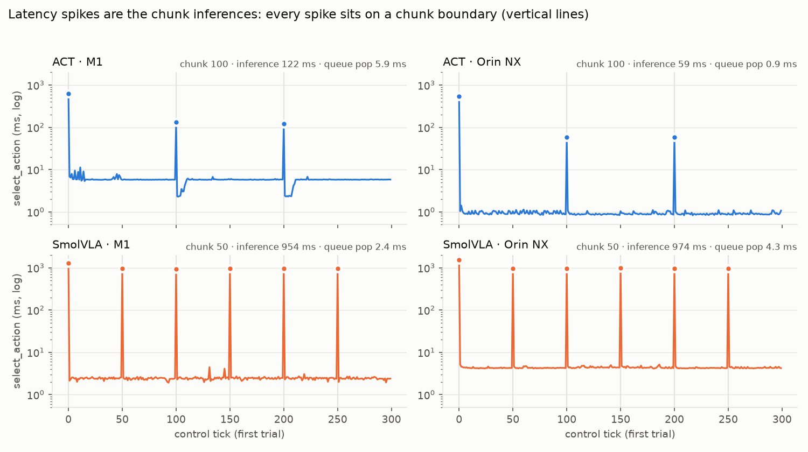

# p99 is not a tail: latency numbers that lie about chunked policies

My first gate runs reported `select_action` latency the usual way: p50 and p99 per trial. For SmolVLA on a Jetson Orin NX, p50 was a few milliseconds and p99 was about a second. That reads like a fast policy with an occasional hiccup.

It is not. Every one of those slow calls was a full chunk inference, on a fixed schedule, and the control loop spent 39 % of every trial blocked on them. For chunked policies, p50 and p99 describe two different operations, not one distribution.

<!-- more -->

## The symptom

A chunked policy predicts H actions at once (ACT: 100, SmolVLA: 50) and queues them. The next H − 1 calls to `select_action` only pop the queue. When the queue is empty, the next call runs the model.

In a synchronous loop the robot waits for that call. On the arm this showed as a visible pause at every chunk, and the control-rate table looked inconsistent:
- ACT on the Orin was twice as fast per inference as on the M1 Mac;
- SmolVLA ran at about 19 Hz with about 130 ms of jitter on *both* machines.

## How it was caught

The harness logs one tick file per trial, with the latency of every `select_action` call and its timestamp. A short script (`shared/gate/chunk_latency.py`) does three things:
- flags calls slower than 10 × the trial's median;
- checks whether each flagged call falls on a chunk boundary (call 0, H, 2H, …);
- plots the first 300 calls of one trial with the boundaries drawn.



The spikes are not a tail. They are the boundaries:

| policy | machine | chunk | spikes on a chunk boundary | chunk inference | queue pop | p99 | chunk inferences / s | sync loop blocked |
|---|---|---|---|---|---|---|---|---|
| ACT | M1 | 100 | 100 % | 122 ms | 5.86 ms | 118 ms | 0.32 | 4 % |
| ACT | Orin NX | 100 | 100 % | 59 ms | 0.92 ms | 58 ms | 0.32 | 2 % |
| SmolVLA | M1 | 50 | 98 % | 954 ms | 2.42 ms | 954 ms | 0.41 | **39 %** |
| SmolVLA | Orin NX | 50 | 100 % | 974 ms | 4.29 ms | 975 ms | 0.40 | **39 %** |

10 trials of 25 s per row, 30 Hz loop, 2026-09-29. The two off-boundary SmolVLA spikes on the M1 (2 of 102) are isolated outliers.

## What the right numbers say

- **p50 is the queue pop.** p99 is one chunk inference.
- **The useful numbers** are the *time per chunk inference* and *how often it runs*. Together they give how long the robot stalls and how often, and so the share of the trial the loop is blocked.
- **The control-rate puzzle resolves.** SmolVLA is bound by its own inference (about 0.95–0.97 s on both machines), so faster hardware did not help it. ACT, at 59 ms per 100 actions, barely blocks at all.
- **The lever was not "more hardware".** It was the engine, then asynchronous inference.

Moving SmolVLA from PyTorch to vla.cpp on the same Orin and checkpoint (2026-10-01, 10 trials each), the metrics that matter moved:

| | SmolVLA PyTorch | vla.cpp defaults | vla.cpp `--flash-attn --mm-prec default` |
|---|---|---|---|
| chunk inference | 974 ms | 390 ms | **238 ms** |
| sync loop blocked | 39 % | 20 % | **14 %** |
| control Hz achieved | 19.32 | 24.59 | **26.56** |
| control jitter | 130.7 ms | 51.0 ms | **29.8 ms** |
| success (n = 10) | 9/10 | 9/10 | 8/10 |

Spikes still sit on the boundaries (100 / 100 / 99 %). The stall is shorter, not gone. That is what led to running inference asynchronously, and to the [chunk-boundary post](https://ravediamond.github.io/blog/2026/10/25/vla-chunk-boundary-jumps/).

## What is not proven

- **Synchronous loop only.** The asynchronous loop on the arm, where inference overlaps execution, has not been timed end to end. That timing run (G13a) has not happened.
- **n = 10 trials per row**, one task, two machines. The percentages are stable across trials here, but this is not a benchmark suite.
- **Success at n = 10 says nothing either way** about the engine change (9 vs 9 vs 8). The `_fa` flags change numerics, and its two missed grasps are flagged, not explained.

## The reusable check

For any chunked policy, compute these from per-call logs instead of reporting p50 / p99:

```python
def summarize(trials: list[dict], chunk: int) -> dict:
    spikes, rest, on_boundary, blocked, wall = [], [], 0, 0.0, 0.0
    for t in trials:
        s = np.array(t["select_action_ms"])
        idx = np.where(s > 10 * np.median(s))[0]
        on_boundary += int(np.sum(idx % chunk == 0))
        spikes += s[idx].tolist()
        rest += np.delete(s, idx).tolist()
        ts = np.array(t["tick_ts"])
        wall += ts[-1] - ts[0]
        blocked += s[idx].sum() / 1e3
    return {
        "spikes": len(spikes),
        "on_boundary_pct": 100 * on_boundary / len(spikes),
        "chunk_ms": float(np.median(spikes)),
        "pop_ms": float(np.median(rest)),
        "p99_ms": float(np.percentile(spikes + rest, 99)),
        "chunks_per_s": len(spikes) / wall,
        "blocked_pct": 100 * blocked / wall,
    }
```

If `on_boundary_pct` is near 100, report `chunk_ms`, `chunks_per_s` and `blocked_pct`. Treat p99 as what it is: one inference.

## Links

- Earlier posts:
  - [three policies on a $300 arm](https://ravediamond.github.io/blog/2026/09/29/three-policies-on-a-300-dollar-arm/);
  - [SmolVLA four times faster with vla.cpp](https://ravediamond.github.io/blog/2026/10/01/smolvla-4x-faster-on-jetson-with-vlacpp/).
- Tick files and `chunk_latency.py`: in my research repo, public with the replication repo.
- Every test and verdict: the [paper vs hardware page](https://ravediamond.github.io/papers/).
